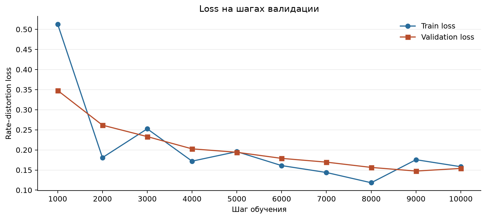
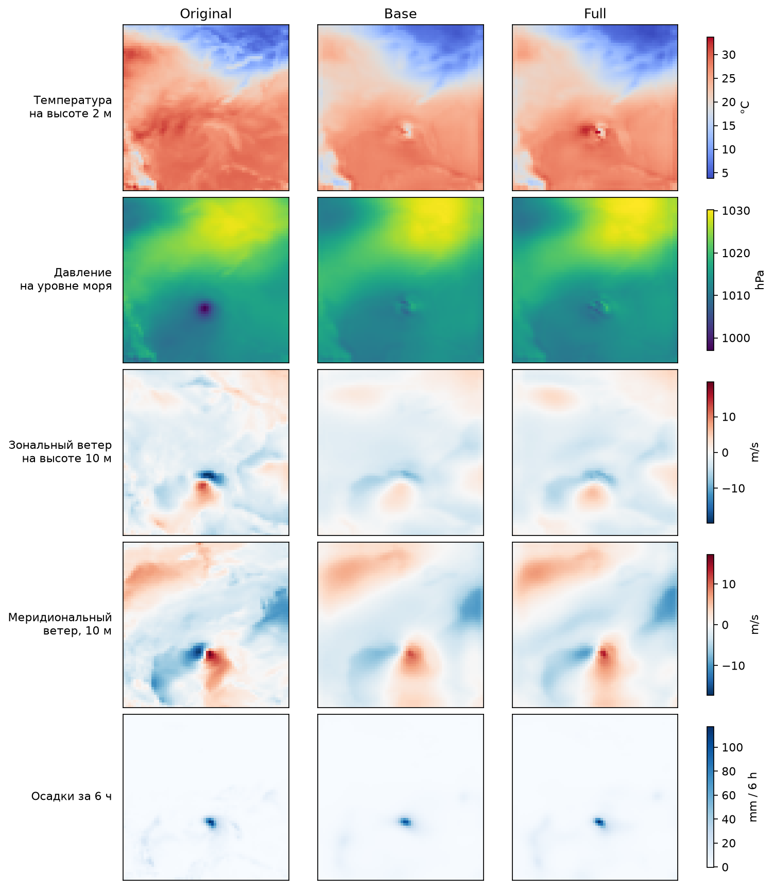

# SPARC-ERA5

Нейросетевой кодек для сжатия метеорологических полей ERA5  
Nuclear IT Hack School 2026, кейс AIRI, второе место в командном соревновании

Свёрточный автоэнкодер кодирует 28 полей ERA5 в два латентных представления  
Поток Base даёт самостоятельную реконструкцию, а Full добавляет Detail  
Для обоих потоков используется энтропийное кодирование CompressAI

## Запуск

Используйте Python 3.12 и отдельное окружение  
Для сборки CompressAI под Windows нужны MSVC C++17 и Windows SDK

```sh
python -m pip install -r requirements.txt
python -m src.prepare_era5 --output data/train.zarr --start 2014-01-01 --stop 2020-01-01 --frames 128
python -m src.prepare_era5 --output data/validation.zarr --start 2020-01-01 --stop 2021-01-01 --frames 32
python -m src.train --data data/train.zarr --validation-data data/validation.zarr --run runs/seed42
```

Исходные поля берутся из архива ERA5 с шагом 6 часов и приводятся к сетке 0,5 градусов [WeatherBench 2](https://weatherbench2.readthedocs.io/en/latest/data-guide.html#era5)  
Конфигурация в коде задаёт 10 000 шагов, размер батча 4, скорость обучения `2e-4`, seed 42 и валидацию каждые 1000 шагов

Для воспроизведения результатов используйте те же 128 train-кадров для пересчёта нормализации опубликованных весов

```sh
python -m src.evaluate --checkpoint best.pt --train-data data/train.zarr --data data/validation.zarr --run runs/published
```

## Результаты

Лучший checkpoint сохранён на шаге 9000, loss валидации 0,1474  
Фактические измерения получены после кодирования и декодирования 128 патчей `64 × 64` из 32 валидационных кадров

| Режим | Нормализованный RMSE | Коэффициент сжатия |
| --- | ---: | ---: |
| Base | 0,2686 | 983,44x |
| Full | 0,2337 | 376,47x |

Коэффициент делит исходный объём погодных значений float32 на объём потоков с заголовками, без учёта весов и статических полей  
[График RMSE](results/rmse.png) показывает взвешенную ошибку по ходу обучения, а [график сжатия](results/compression_ration.png) показывает оценку по вероятностям модели





